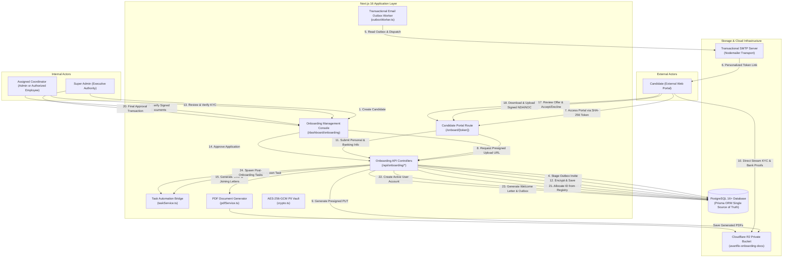

# AVANFlix Work Tracker — Employee Onboarding Architecture

**Module:** Employee Recruitment & Onboarding Lifecycle  
**Architecture Version:** 2.0.0 (Phase 0 Final Architecture Specification)  
**Target Platform:** Next.js 16.2.10 (Turbopack, App Router) | PostgreSQL 16+ via Prisma ORM | Cloudflare R2  
**Status:** Architecture Blueprint for Executive Review  

---

## 1. Executive Summary & Strategic Architectural Pivot

This architecture blueprint specifies the enterprise expansion of the **AVANFlix Work Tracker** (`employee-work-tracker`) into an integrated **HR & Employee Lifecycle Management System**.

### 1.1 The Final Database Decision
Following executive architectural review, the database strategy for AVANFlix Work Tracker is **final and absolute**:
- **PostgreSQL 16+ is the sole, permanent application database.**
- **Prisma ORM** is the designated enterprise ORM across the entire system.
- **MongoDB and Mongoose are permanently scheduled for full decommissioning.** MongoDB is retained strictly as the read-only legacy source during data extraction and the 14-day contingency rollback window.
- **No Temporary Dual-Database Implementation:** The new Recruitment and Onboarding subsystem will **NOT** be authored against MongoDB. It will be implemented natively in PostgreSQL following full platform database migration.
- **Cloudflare R2** serves as the private, encrypted object storage for all uploaded and generated documents, images, and legal agreements.

### 1.2 Core System Goals
1. **End-to-End Recruitment Orchestration:** Digitize candidate profile initiation, tokenized public application submission, multi-tier KYC verification, automated document generation, digital signature workflows, and final employee account provisioning.
2. **Automated Internal Coordination:** Auto-generate trackable onboarding tasks within the existing Task management engine, assigning duties to designated coordinators with instant in-app alerts and WhatsApp dispatches.
3. **Atomic Employee ID Allocation:** Enforce the enterprise employee ID format (`D` + designation initial + `000` + 4 random digits, e.g. `DW0008449`), backed by a centralized, permanent `EmployeeIdRegistry` table that prevents duplicate allocations and guarantees zero ID reuse.
4. **Outbox-Pattern Email Reliability:** Decouple transactional email dispatches from database transactions via an asynchronous `EmailOutbox` engine, ensuring zero database rollback due to external SMTP network latency or transient server failures.
5. **Strict Data Privacy & Legal Compliance:** Ensure full alignment with the Indian Digital Personal Data Protection (DPDP) Act 2023 and UIDAI Aadhaar masking circulars, utilizing AES-256-GCM encryption for sensitive fields and short-lived pre-signed R2 URLs.

---

## 2. End-to-End System Architecture

---

## 3. Subsystem Breakdown & Architectural Components

### 3.1 Candidate Lifecycle & State Machine
The recruitment pipeline moves through 14 immutable, independently tracked stages:
1. `INVITED`: Candidate profile created by Super Admin; invitation token generated.
2. `APPLICATION_SUBMITTED`: Candidate completed personal info, KYC uploads, and banking details.
3. `UNDER_REVIEW`: Assigned coordinator is inspecting uploaded documents and data.
4. `CORRECTION_REQUESTED`: Reviewer identified deficiencies; portal re-opened with notes.
5. `APPLICATION_APPROVED`: Candidate information and KYC verified and approved.
6. `OFFER_SENT`: Offer Letter and Joining Letter generated and dispatched (Email 1).
7. `OFFER_ACCEPTED`: Candidate explicitly confirmed acceptance of compensation and terms.
8. `OFFER_DECLINED`: Candidate formally rejected the employment offer.
9. `DOCUMENTS_PENDING`: NDA and NOC forms dispatched for wet/digital signature (Email 2).
10. `DOCUMENTS_SUBMITTED`: Candidate re-uploaded signed copies of NDA and NOC.
11. `DOCUMENTS_VERIFIED`: Coordinator confirmed signatures and dates are authentic and valid.
12. `FINAL_APPROVAL_PENDING`: All formalities satisfied; awaiting Super Admin authorization.
13. `COMPLETED`: Employee ID allocated, User account provisioned, Welcome email queued.
14. `REJECTED`: Candidate terminated at review stage; portal access permanently revoked.

### 3.2 Employee ID Registry Subsystem (`employee_id_registry`)
To avoid race conditions and guarantee organization-wide uniqueness:
- **Dedicated Central Registry:** Employee IDs are not generated ad-hoc or managed through disconnected table indexes. All allocated IDs live in an explicit `EmployeeIdRegistry` table.
- **Strict Format:** `D` + Designation Initial + `000` + 4-digit numeric sequence (e.g., `DW0008449` for Web Developer, `DD0001234` for Designer, `DA0005678` for Accountant).
- **Atomic Reservation:** ID generation executes inside an isolated database transaction using PostgreSQL `SELECT ... FOR UPDATE` or atomic insertion with collision retry loops (up to 10 iterations).
- **Zero Reuse Policy:** An allocated employee ID is permanently bound. Even if an employee leaves the company or an onboarding is cancelled post-approval, the ID status is marked `RETIRED` and is never recycled.
- **Generation Invariant:** Generated **strictly upon final onboarding approval**, never during initial candidate creation or offer stages.

### 3.3 Transactional Outbox Pattern for Email Dispatches
Network communication with external SMTP servers must never participate in database transactions. To eliminate connection hang-ups, timeout aborts, or partial rollbacks:
1. All notification emails (Invitation, Offer Package, Legal Agreements, Welcome Letter) are written to the `email_outbox` table within the same PostgreSQL transaction that mutates the candidate's state.
2. A lightweight background worker polls the outbox table every 5 seconds, dispatches emails with exponential backoff retries (up to 5 attempts), and marks them `SENT` or `FAILED`.
3. If an SMTP server is unreachable, the candidate's database state remains perfectly consistent and intact.

### 3.4 Cloudflare R2 Document & Image Storage Architecture
- **Private Bucket Isolation:** The bucket `avanflix-onboarding-docs` is 100% private. Public access, bucket browsing, and direct object URLs are blocked.
- **Server-Side Controlled Pre-signed URLs:**
  - *Direct Upload:* Frontend requests a pre-signed `PUT` URL specifying file size, content type, and SHA-256 checksum. Upload streams directly from the candidate browser to Cloudflare R2.
  - *Protected Download:* Viewing KYC proofs or signed agreements requires an authenticated API call that verifies role permissions and returns a pre-signed `GET` URL expiring in 300 seconds (5 minutes).
- **Deterministic Server-Generated Object Keys:** Clients never dictate storage paths. Keys are strictly formatted:
  - KYC Proofs: `candidates/{candidateId}/kyc/{documentType}_{timestamp}_{uuid}.pdf`
  - Bank Proofs: `candidates/{candidateId}/bank/cheque_{timestamp}_{uuid}.jpg`
  - Signed Agreements: `candidates/{candidateId}/signed/{documentType}_v{version}_{uuid}.pdf`
  - System Documents: `candidates/{candidateId}/generated/{documentType}_v{version}.pdf`
- **Zero Sensitive Email Attachments:** To comply with data privacy standards, emails never attach Aadhaar, PAN, or banking documents. All sensitive document access occurs inside authenticated, expiring viewing sessions.

---

## 4. Legal Compliance & Data Privacy Vault

### 4.1 Indian DPDP Act 2023 & UIDAI Aadhaar Regulations
- **Aadhaar Storage Restrictions:** In accordance with UIDAI regulations, storing raw, unmasked 12-digit Aadhaar numbers is prohibited unless operating a certified Aadhaar Vault. AVANFlix stores:
  1. `aadhaar_last_four`: Plain text for verification (e.g. `1234`).
  2. `aadhaar_number_encrypted`: AES-256-GCM encrypted payload, accessible only during KYC audit.
  3. Aadhaar front/back scans: Processed with mandatory guidance to candidates to upload masked Aadhaar copies where possible.
- **PAN & Banking Vault:** PAN numbers and Bank Account numbers are encrypted using application-level AES-256-GCM encryption with 128-bit authentication tags.
- **Key Separation:** The `PII_ENCRYPTION_KEY` is maintained strictly within system environment variables and cloud key management, never persisted in database tables or logs.

---

## 5. Architectural Invariants for Implementation

1. **Database Migration First:** Full PostgreSQL migration (Phases 1–3 of Roadmap) must be completed before authoring the Onboarding subsystem (Phase 4).
2. **Immutable Audit History:** Every status modification, document rejection, verification sign-off, and administrative override is permanently recorded in `onboarding_audit_logs`.
3. **No Phantom User Records:** A candidate is provisioned into the `users` table **only** at the `COMPLETED` milestone.
