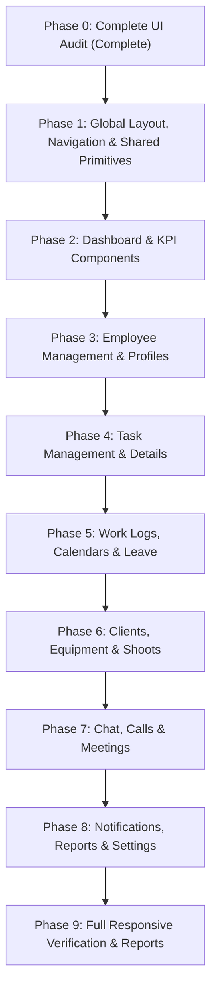

# AVANFlix Work Tracker — Complete Mobile Responsiveness Audit (Phase 0)

**Project:** employee-work-tracker  
**Version:** 1.0.0  
**Stack:** Next.js 16.2.10 (App Router), React 19, Tailwind CSS, Radix UI Primitives, Lucide Icons, Recharts  
**Audit Date:** November 21, 2026  
**Auditor:** Senior Frontend Architect & Responsive UI/UX Engineer  
**Status:** Complete — Ready for Implementation (Phases 1–9)  

---

## 1. Executive Summary & Responsive System Strategy

### 1.1 Priority Directive
All work on the **Employee Recruitment & Onboarding Module** and **MongoDB-to-PostgreSQL migration** has been placed on **HOLD**. The sole and exclusive focus is achieving full mobile and tablet responsiveness across the entire existing AVANFlix Work Tracker application without regressing, altering, or degrading any desktop functionality, business logic, RBAC rules, or API contracts.

### 1.2 Viewport & Breakpoint Matrix
The audit evaluates all views against the following standard SaaS responsive design system:

| Tier | Breakpoint Range | Typical Target Devices | Layout Archetype |
| :--- | :--- | :--- | :--- |
| **Small Mobile** | `320px – 374px` | iPhone SE (1st/2nd Gen), Galaxy A-series | 1-column, compact pills, minimal headers, 100% full-width cards |
| **Standard Mobile** | `375px – 479px` | iPhone 12/13/14/15/16, Galaxy S21/S24, Pixel 7/8 | 1-column, full touch targets ($\ge 44\text{px}$), stacked cards |
| **Large Mobile** | `480px – 767px` | Large Phablets, landscape phones | 1-to-2 column adaptive grids, inline search + action buttons |
| **Tablet** | `768px – 1023px` | iPad Mini, iPad 10th Gen, Galaxy Tab S9 | Collapsible navigation, 2-to-3 column grids, scrollable wide tables |
| **Laptop** | `1024px – 1439px` | MacBook Air, standard 13"–14" laptops | Persistent sidebar (`w-64`), multi-column dashboards, full tables |
| **Desktop / Wide** | `1440px+` | External 2K/4K displays, ultrawide monitors | Max-width content constraint (`max-w-7xl mx-auto`), full data density |

---

## 2. Shared Components & Architectural Layout Inspection

Before evaluating individual pages, the shared application shell, primitives, and styling rules were audited:

### 2.1 Dashboard Layout & Main Shell (`app/dashboard/layout.tsx`)
- **Current Behavior:** Desktop sidebar is wrapped in `
<Sidebar role={role} />
`. Main content area has `className="flex-1 bg-background p-4 md:p-6"`.
- **Identified Issues:**
  1. At 320px–374px screen width, `p-4` creates 32px of horizontal gutters, leaving only 288px width. When internal pages nest additional padding (`p-6` or `p-8` in cards), usable width drops below 240px.
  2. No safe-area inset support (`env(safe-area-inset-bottom)` / `env(safe-area-inset-top)`) for iOS notched screens and Android bottom navigation bars.
- **Required Changes:**
  - Main container padding updated to `p-3 sm:p-4 md:p-6`.
  - Add safe-area padding helper to root shell.
- **Desktop Regression Risk:** Zero. Desktop retains `md:p-6` and persistent sidebar.
- **Priority:** Critical (P0).

### 2.2 Navigation Top Bar (`components/common/Navbar.tsx`)
- **Current Behavior:** Sticky header with AFX logo, mobile hamburger menu, Availability status dropdown, Notifications bell, user profile, and sign-out button.
- **Identified Issues:**
  1. **Availability Status Overflow:** `<AvailabilityStatus />` uses a fixed `<SelectTrigger className="w-[160px]">`. On a 320px–375px viewport, 160px consumed by the dropdown plus logo and action icons causes the topbar to overflow horizontally or wrap onto two lines.
  2. **Touch Target Deficit:** Hamburger menu button uses `p-2` on a 20px icon (~36px target), below the 44px ergonomic touch standard.
  3. **Drawer Usability & Scroll Lock:** When the mobile navigation drawer opens, background body scrolling is not locked (`overflow: hidden` is omitted on body), allowing users to accidentally scroll the page behind the drawer.
  4. **Keyboard Accessibility:** Escape key does not dismiss the mobile drawer.
- **Required Changes:**
  - Update `AvailabilityStatus` trigger to `w-11 sm:w-36 md:w-40` with compact status dot on small mobile (`< 480px`) and full label on larger screens.
  - Set menu trigger and close button dimensions to minimum 44px touch bounding box (`h-11 w-11 flex items-center justify-center`).
  - Add `useEffect` body scroll-locking and `Escape` key event listener when drawer is open.
- **Desktop Regression Risk:** None; desktop hides the hamburger and displays the full user avatar and badge.
- **Priority:** Critical (P0).

### 2.3 Navigation Sidebar (`components/common/Sidebar.tsx`)
- **Current Behavior:** Fixed `w-64` aside with logo, navigation links with icons and badge counters, PWA install button, and user role footer.
- **Identified Issues:**
  - Navigation links have `px-3 py-2.5` (~38px height). On mobile touchscreens, links are slightly cramped for finger tapping.
  - When used inside the mobile slide-out sheet, tapping a link correctly invokes `onNavigate` but lacks active tap feedback.
- **Required Changes:**
  - Increase mobile nav item vertical padding to `py-3` on mobile (`py-3 md:py-2.5`) to hit 44px tap target height.
- **Desktop Regression Risk:** Zero.
- **Priority:** High (P1).

### 2.4 Modal & Dialog Primitives (`components/ui/dialog.tsx`)
- **Current Behavior:** Radix DialogContent has `className="fixed left-1/2 top-1/2 z-50 w-full max-w-lg -translate-x-1/2 -translate-y-1/2 rounded-2xl border border-border bg-card p-6 shadow-xl glass"`.
- **Identified Issues:**
  1. `w-full max-w-lg` without responsive margins touches the physical edges of mobile screens on viewports $< 512\text{px}$.
  2. Long modal forms (such as `TaskForm`, `EmployeeForm`, `ShootLogForm`, `AvailabilityForm`) exceed the mobile viewport height in portrait mode and especially in landscape mode. Because `DialogContent` lacks `max-h-[calc(100dvh-2rem)]` and `overflow-y-auto`, the modal bottom and action buttons (Submit, Cancel) are clipped offscreen and cannot be reached.
  3. Close button `p-1` with 16px icon yields ~24px touch target, causing frequent missed taps on touch devices.
- **Required Changes:**
  - Update `DialogContent` classes: `w-[calc(100%-1.5rem)] sm:w-full max-w-lg max-h-[calc(100dvh-2rem)] overflow-y-auto p-4 sm:p-6 rounded-2xl`.
  - Close button touch target enlarged to `h-10 w-10 flex items-center justify-center rounded-xl p-2`.
- **Desktop Regression Risk:** Zero. On desktop (`sm:`), width is `max-w-lg`, padding is `p-6`.
- **Priority:** Critical (P0).

### 2.5 Table Container Primitive (`components/ui/table.tsx`)
- **Current Behavior:** Standard HTML `<table>` wrapped in `
`.
- **Identified Issues:**
  - While horizontal scroll is enabled via `overflow-auto`, wide tables (TaskTable with 7 columns, EmployeeTable with 8 columns, ClientTable with 5 columns + 6 action buttons) force mobile users to scroll sideways repeatedly to inspect status, deadline, or click action buttons.
  - Tables with small text become unreadable without responsive card transformation or selective column visibility.
- **Required Changes:**
  - Maintain desktop tabular view on `md:` ($768\text{px}+$).
  - For mobile viewports ($< 768\text{px}$), render structured, readable card stacks containing all data fields, badges, and primary action buttons.
- **Desktop Regression Risk:** Zero. Desktop maintains full `<table>` layout.
- **Priority:** High (P1).

### 2.6 Form Controls & Input Zoom Prevention (`components/ui/input.tsx`, `textarea.tsx`, `select.tsx`)
- **Current Behavior:** Form controls specify `text-sm` (14px).
- **Identified Issues:**
  - On iOS Mobile Safari, any input with font size $< 16\text{px}$ triggers an involuntary page zoom on focus, displacing the layout and causing accidental horizontal panning.
- **Required Changes:**
  - Apply `text-base sm:text-sm` across `Input`, `Textarea`, and `SelectTrigger`.
  - Maintain 44px minimum touch target height on inputs (`h-11 sm:h-10`).
- **Desktop Regression Risk:** None; desktop viewports continue to use 14px (`sm:text-sm`).
- **Priority:** High (P1).

---

## 3. Page-by-Page Audit Matrix

### 3.1 Dashboard Overview (`app/dashboard/page.tsx`, `AdminOverview.tsx`, `EmployeeOverview.tsx`)
- **Current Mobile Behavior:**
  - Stat cards display in a 2-column grid (`grid-cols-2 md:grid-cols-4`).
  - Tasks by status pie chart is stacked above Recent Tasks table.
  - `TeamTodayPanel` renders active employee avatar buttons in a 2-column grid.
- **Identified Issues:**
  1. On 320px–360px screens, `StatCard` padding (`p-5`) with 2 columns causes text labels like "UPCOMING DEADLINES" to wrap onto 3 lines and crowd the icon.
  2. In `TeamTodayPanel`, the header search input has `max-w-[220px]`, causing awkward wrap against the title on narrow screens.
  3. Clicking an employee in `TeamTodayPanel` opens `EmployeeTasksDialog`. The dialog header contains an Avatar, Title, Description, and an "Assign task" button in a horizontal flexbox, causing the title to clip severely on mobile.
- **Required Changes:**
  - Adjust `StatCard` padding to `p-3.5 sm:p-5`, label size to `text-[10px] sm:text-xs`, and number font to `text-xl sm:text-2xl`.
  - In `TeamTodayPanel`, make search bar full-width on mobile (`w-full sm:w-56`), and wrap dialog header into `flex-col sm:flex-row gap-3`.
- **Components Affected:** `AdminOverview.tsx`, `EmployeeOverview.tsx`, `StatCard.tsx`, `TeamTodayPanel.tsx`, `TasksByStatusChart.tsx`.
- **Desktop Regression Risk:** None.
- **Priority:** High (P1).

---

### 3.2 Employee Directory (`app/dashboard/employees/page.tsx`)
- **Current Mobile Behavior:**
  - Page header has title and "Add employee / admin" button.
  - Search bar in card header.
  - `EmployeeTable` renders 8 table columns inside horizontal scroll container.
- **Identified Issues:**
  1. "Add employee / admin" button text is long and wraps awkwardly on 320px–360px screens.
  2. `EmployeeTable` has 8 columns: Employee, Department, Designation, Role, Joined, Status, Availability, Actions. On mobile, action buttons (Eye, Activate/Deactivate, WhatsApp) are hidden offscreen to the right, requiring horizontal panning.
  3. `EmployeeForm` dialog uses 2-column grids (`grid grid-cols-2 gap-3`) for First/Last name, Temporary password/Role, and Department/Designation, cramming input fields on 320px–375px screens.
- **Required Changes:**
  - In `EmployeesPage`, make the action button responsive (`w-full sm:w-auto`).
  - In `EmployeeTable`, introduce a mobile card view (`block md:hidden`) displaying the employee's name, email, department, role badge, status, availability window, and direct action buttons, while keeping the full `Table` on `md:` ($768\text{px}+$).
  - In `EmployeeForm`, convert input grids to `grid-cols-1 sm:grid-cols-2`.
- **Components Affected:** `app/dashboard/employees/page.tsx`, `EmployeeTable.tsx`, `EmployeeForm.tsx`.
- **Desktop Regression Risk:** Zero. Desktop table preserved exactly.
- **Priority:** High (P1).

---

### 3.3 Employee Detail Drilldown (`app/dashboard/employees/[id]/page.tsx`)
- **Current Mobile Behavior:**
  - Profile header card with avatar, name, badges, and 3 buttons (Edit Details, Availability, Assign Task).
  - 4 stats cards (`grid-cols-2 md:grid-cols-4`).
  - 2 profile info cards (`grid gap-6 md:grid-cols-2`).
  - Assigned tasks list.
  - `WorkLogCalendar`.
- **Identified Issues:**
  1. Profile header action buttons (`Edit Details`, `Availability`, `Assign Task`) wrap into an uneven cluster on mobile.
  2. Profile information rows (`flex items-center justify-between`) cause overlapping text when email or department name is long.
  3. Assigned task items inside card: progress bar (`w-24`), status badge, and "View" button wrap onto 3 separate lines on mobile.
  4. Assigned tasks header has title and "Assign Task" button in a `flex-row justify-between` that collides on small mobile.
- **Required Changes:**
  - Header actions: `w-full sm:w-auto` with flex column on small screens.
  - Information rows: `flex-col sm:flex-row items-start sm:items-center justify-between gap-1 sm:gap-2`.
  - Task item row: Clean vertical mobile stack with progress bar full-width and action button accessible.
  - Header title & button: `flex-col sm:flex-row gap-3`.
- **Components Affected:** `app/dashboard/employees/[id]/page.tsx`, `EditEmployeeModal.tsx`, `AvailabilityForm.tsx`.
- **Desktop Regression Risk:** Zero.
- **Priority:** High (P1).

---

### 3.4 Task Management List & Calendar (`app/dashboard/tasks/page.tsx`)
- **Current Mobile Behavior:**
  - Header with title, view switcher (List vs. Calendar), and "Assign task" button.
  - Filter row with Search input and 3 `Select` dropdowns (Assignee, Status, Priority).
  - `TaskTable` or `TaskCalendar`.
- **Identified Issues:**
  1. Header actions (List/Calendar toggle + "Assign task" button) wrap into 2-3 lines on 320px–390px screens.
  2. Filter bar has fixed Select triggers (`w-56`, `w-40`, `w-36`). On mobile, this produces an ugly 4-row filter layout where selects take arbitrary widths.
  3. `TaskTable` has 7 columns (Task, Employee, Priority, Status/Checklist, Progress, Deadline, Actions). On mobile phones, employees cannot see the "Update Task" or "Transfer" button without scrolling horizontally across 6 columns!
  4. Task creation dialog (`TaskForm`) inside modal uses 2-column grids for Department & Priority, Start Date & Deadline.
- **Required Changes:**
  - Filter bar: `flex flex-col sm:flex-row gap-2` with `w-full sm:w-auto` selects (or responsive grid).
  - `TaskTable`: Provide a high-visibility mobile card view on $< 768\text{px}$ showcasing task title, priority badge, stage/status badge, deadline (with overdue indicator), progress bar, and immediate "Update Task" / "Transfer" buttons.
  - `TaskForm`: Convert 2-column input rows to `grid-cols-1 sm:grid-cols-2`.
- **Components Affected:** `app/dashboard/tasks/page.tsx`, `TaskTable.tsx`, `TaskForm.tsx`.
- **Desktop Regression Risk:** Zero. Desktop keeps the 7-column table.
- **Priority:** Critical (P0).

---

### 3.5 Task Detail & Progress Update (`app/dashboard/tasks/[id]/page.tsx`)
- **Current Mobile Behavior:**
  - Back button, task title card with badges, task description, progress bar.
  - `TaskChecklistCard` with multi-step pipeline, deliverable link inputs, changes/notes.
  - Side-by-side grid (`grid gap-6 lg:grid-cols-2`) for Update Task form and Activity Timeline.
- **Identified Issues:**
  1. Header badges (Priority, Status, Stage, Transfer button) wrap onto 3 lines on mobile screens.
  2. `TaskChecklistCard`: "+ Add another" link button and "Save details" button have small touch areas.
  3. Deliverable links list: long URLs without wrapping can overflow container horizontally.
  4. `TaskUpdateForm`: Sliders and time spent inputs need sufficient spacing from mobile virtual keyboard.
- **Required Changes:**
  - Header badges: `flex flex-wrap items-center gap-1.5`.
  - `TaskChecklistCard`: Ensure deliverable URLs have `break-all` (already present), and buttons have minimum 44px tap area.
  - `TaskUpdateForm`: Inputs configured with `text-base sm:text-sm` to avoid mobile browser auto-zoom.
- **Components Affected:** `app/dashboard/tasks/[id]/page.tsx`, `TaskChecklistCard.tsx`, `TaskUpdateForm.tsx`, `DelayForm.tsx`.
- **Desktop Regression Risk:** Zero.
- **Priority:** High (P1).

---

### 3.6 Work Logs & Calendar Operations (`app/dashboard/work-log/page.tsx`)
- **Current Mobile Behavior:**
  - Header banner, submit work log form, guidelines card, and `WorkLogCalendar`.
  - For Admins/Super Admins, renders `TeamWorkLogCalendars`.
- **Identified Issues:**
  1. **Excessive Padding:** Page wrapper has `mx-auto max-w-6xl space-y-8 p-6`. Combined with layout `p-4` and card `p-8`, 70px+ is wasted on mobile margins.
  2. **Severe 7-Column Grid Cramping:** `WorkLogCalendar` renders `grid grid-cols-7 gap-2` with `min-h-[86px]`. On a 360px screen, each day cell is compressed to ~35px width. Text labels ("Logged", "No entry", "LEAVE") overflow out of cells, numbers collide, and tapping a 35px cell is nearly impossible on touch screens.
  3. In `TeamWorkLogCalendars`, member select dropdown and overview card header collide on mobile.
- **Required Changes:**
  - Reduce outer padding on mobile: `p-3 sm:p-6`, card padding `p-4 sm:p-6 md:p-8`.
  - In `WorkLogCalendar`, implement a dual-mode responsive layout:
    - On mobile ($< 640\text{px}$), provide a toggle between **Month View** (compact dots/pills) and **Agenda List View** (chronological daily entries with one-tap work logging), OR a horizontally swipeable/scrollable week/month container.
  - In `TeamWorkLogCalendars`, stack member selector cleanly (`w-full sm:w-72`).
- **Components Affected:** `app/dashboard/work-log/page.tsx`, `WorkLogCalendar.tsx`, `TeamWorkLogCalendars.tsx`, `WorkLogForm.tsx`.
- **Desktop Regression Risk:** None; desktop preserves the full 7-column month grid.
- **Priority:** Critical (P0).

---

### 3.7 Shoots & Equipment Management (`app/dashboard/shoots/page.tsx`)
- **Current Mobile Behavior:**
  - Page header with "Manage equipment" and "Log checkout" buttons.
  - View switcher (Mine, Team, Calendar).
  - `ShootLogsTable` or `ShootCalendar`.
- **Identified Issues:**
  1. Header action buttons wrap awkwardly on $< 480\text{px}$.
  2. `ShootCalendar` uses fixed 7-column month grid, compressing shoot titles on narrow viewports.
  3. `ShootLogsTable` accordion item items list (`flex items-center justify-between`) wraps tightly when equipment names are long.
  4. `EquipmentCatalogManager` dialog content overflows vertically on mobile without internal scroll.
- **Required Changes:**
  - Header actions: `w-full sm:w-auto flex-wrap`.
  - `ShootCalendar`: Add agenda/list view toggle for mobile devices.
  - `ShootLogsTable`: Responsive badge wrapping and full-width "Log return" button.
- **Components Affected:** `app/dashboard/shoots/page.tsx`, `ShootLogsTable.tsx`, `ShootCalendar.tsx`, `ShootLogForm.tsx`, `EquipmentCatalogManager.tsx`.
- **Desktop Regression Risk:** Zero.
- **Priority:** Medium (P2).

---

### 3.8 Content Delivery Calendar (`app/dashboard/deliveries/page.tsx`)
- **Current Mobile Behavior:**
  - Client selector, reference links (Deck, Deliverables, Content, MOU), and `DeliveryCalendar`.
- **Identified Issues:**
  1. Reference links wrap into multiple lines on mobile screens.
  2. `DeliveryCalendar` renders `grid grid-cols-7 gap-1.5 auto-rows-[6rem] sm:auto-rows-[7rem]`. On mobile ($320\text{px}–480\text{px}$), event pills with client names and times overflow cell boundaries.
- **Required Changes:**
  - Add Month / Agenda List toggle on mobile ($< 768\text{px}$) so delivery dates can be viewed as an accessible daily schedule.
  - Ensure client link chips have touch-friendly tap targets.
- **Components Affected:** `app/dashboard/deliveries/page.tsx`, `DeliveryCalendar.tsx`, `DeliveryEventForm.tsx`.
- **Desktop Regression Risk:** Zero.
- **Priority:** High (P1).

---

### 3.9 Clients Management (`app/dashboard/clients/page.tsx`)
- **Current Mobile Behavior:**
  - Page header with "Add client" button.
  - Search input.
  - `ClientTable` with 5 columns + actions.
- **Identified Issues:**
  - `ClientTable` action column contains up to 6 buttons side-by-side (`Deliverables`, `Deck`, `Content`, `Edit`, `Archive/Reactivate`, `Delete`). On mobile, this column alone is ~260px wide, forcing extensive horizontal table scrolling.
- **Required Changes:**
  - In `ClientTable`, provide a mobile card view on $< 768\text{px}$ grouping client name, reference links, active badge, and action buttons in a clean stacked card.
- **Components Affected:** `app/dashboard/clients/page.tsx`, `ClientTable.tsx`, `ClientForm.tsx`, `EditClientDialog.tsx`.
- **Desktop Regression Risk:** Zero.
- **Priority:** Medium (P2).

---

### 3.10 Chat & Real-Time Communication (`app/dashboard/messages/page.tsx`)
- **Current Mobile Behavior:**
  - Card container: `grid h-[calc(100vh-13rem)] grid-cols-1 overflow-hidden md:grid-cols-[300px_1fr]`.
- **Identified Issues:**
  1. **Dual Pane Stacking:** On mobile devices ($< 768\text{px}$), both `ConversationList` and `ChatWindow` render stacked vertically in a single column! Both panes are squished into half-height, rendering chat virtually unusable.
  2. **No Back Navigation:** Once inside a conversation on mobile, there is no back button to return to the conversation list.
  3. **Virtual Keyboard Collision:** When the mobile soft keyboard appears, `100vh-13rem` can push the message composer offscreen.
- **Required Changes:**
  - Implement full-screen mobile master-detail switching:
    - When `!activeId`: render `ConversationList` full-screen.
    - When `activeId`: render `ChatWindow` full-screen with a dedicated **Back to Chats** button in the header.
  - Use `h-[calc(100dvh-10rem)]` for dynamic viewport height adaptation on mobile.
- **Components Affected:** `app/dashboard/messages/page.tsx`, `ConversationList.tsx`, `ChatWindow.tsx`, `NewChatDialog.tsx`.
- **Desktop Regression Risk:** Zero. Desktop preserves the 2-pane split screen (`md:grid-cols-[300px_1fr]`).
- **Priority:** Critical (P0).

---

### 3.11 WebRTC Video & Audio Calls (`app/dashboard/calls/[roomId]/page.tsx`, `CallRoom.tsx`)
- **Current Mobile Behavior:**
  - Call room container: `Card className="h-[calc(100vh-8rem)] overflow-hidden"`.
  - Dynamic grid of video tiles and bottom call action bar.
- **Identified Issues:**
  1. Call control buttons (Mic toggle, Camera toggle, Hang up) use `size="icon"` (~36px). During an active call on mobile, small buttons cause accidental hang-ups or missed taps.
  2. `VideoTile` grid layout on mobile portrait needs 1-column or 2-column layout that maximizes video preview height.
- **Required Changes:**
  - Enlarge call action buttons on mobile to minimum `h-12 w-12 rounded-full` (48px touch targets) with distinct destructive styling for End Call.
  - Update container height to `h-[calc(100dvh-6rem)]`.
- **Components Affected:** `app/dashboard/calls/[roomId]/page.tsx`, `CallRoom.tsx`, `VideoTile.tsx`.
- **Desktop Regression Risk:** Zero.
- **Priority:** High (P1).

---

### 3.12 Leave Management (`app/dashboard/leave/page.tsx`)
- **Current Mobile Behavior:**
  - Header with "Request leave" button.
  - Leave approver settings card (Super Admin).
  - `LeaveRequestsTable` for pending and my requests.
- **Identified Issues:**
  - `LeaveRequestsTable` has 6 columns (Employee, Period, Days, Reason, Status, Actions). Table forces horizontal scrolling on mobile.
  - Approve/Reject buttons inside action column are pushed offscreen on narrow screens.
- **Required Changes:**
  - Provide a mobile card view for leave requests on $< 768\text{px}$ displaying employee, date range, total days, reason text, and direct Approve/Reject/Withdraw buttons.
- **Components Affected:** `app/dashboard/leave/page.tsx`, `LeaveRequestsTable.tsx`, `LeaveRequestForm.tsx`.
- **Desktop Regression Risk:** Zero.
- **Priority:** Medium (P2).

---

### 3.13 Holiday & Meetings Calendars (`app/dashboard/holidays/page.tsx`, `app/dashboard/meetings/page.tsx`)
- **Current Mobile Behavior:**
  - 7-column month calendar grids (`HolidayCalendar`, `MeetingCalendar`).
- **Identified Issues:**
  - 7 columns on 320px–480px screens squeeze holiday/meeting tags into tiny dots or cut off text completely.
- **Required Changes:**
  - Provide an Agenda/List view toggle or list below calendar on mobile screens.
- **Components Affected:** `HolidayCalendar.tsx`, `MeetingCalendar.tsx`, `MeetingDetailDialog.tsx`.
- **Desktop Regression Risk:** Zero.
- **Priority:** Medium (P2).

---

### 3.14 Task Transfers (`app/dashboard/transfers/page.tsx`)
- **Current Mobile Behavior:**
  - Pending approval card and My requests card, both rendering `TransferRequestsTable`.
- **Identified Issues:**
  - `TransferRequestsTable` has 7 columns (Task, Requested by, Transfer to, Reason, Status, Requested date, Actions). On mobile phones, Approve and Reject buttons are hidden offscreen to the right.
- **Required Changes:**
  - Add responsive mobile card layout for transfer requests on $< 768\text{px}$.
- **Components Affected:** `app/dashboard/transfers/page.tsx`, `TransferRequestsTable.tsx`.
- **Desktop Regression Risk:** Zero.
- **Priority:** Medium (P2).

---

### 3.15 Reports & Analytics (`app/dashboard/reports/page.tsx`)
- **Current Mobile Behavior:**
  - Completion % pie chart and Tasks per employee bar chart in `grid gap-4 lg:grid-cols-2`.
- **Identified Issues:**
  - In `BarChart`, XAxis tick labels (employee names) overlap and collide when team has 8+ employees on mobile screens $< 480\text{px}$.
- **Required Changes:**
  - Truncate XAxis names or angle labels on narrow viewports, or convert to horizontal orientation on mobile.
- **Components Affected:** `app/dashboard/reports/page.tsx`.
- **Desktop Regression Risk:** Zero.
- **Priority:** Low (P3).

---

### 3.16 User Profile & Notifications (`app/dashboard/profile/page.tsx`, `notifications/page.tsx`)
- **Current Mobile Behavior:**
  - Profile card and Account card; Notifications card with list.
- **Identified Issues:**
  - Notifications header: title and "Mark all read" button collide on screens $< 360\text{px}$.
  - Notification items: icon + title + message + date wrap well, but touch targets for dismissing or opening could be optimized.
- **Required Changes:**
  - In `NotificationsPage`, wrap header into `flex-col sm:flex-row items-start sm:items-center gap-2`.
- **Components Affected:** `app/dashboard/notifications/page.tsx`, `app/dashboard/profile/page.tsx`.
- **Desktop Regression Risk:** Zero.
- **Priority:** Low (P3).

---

### 3.17 Authentication Pages (`app/(auth)/login/page.tsx`, `app/(auth)/forgot-password/page.tsx`)
- **Current Mobile Behavior:**
  - Centered card layout `w-full max-w-md p-4`.
- **Identified Issues:**
  - Overall layout is responsive, but input font size is 14px (`text-sm`), triggering iOS Safari auto-zoom.
- **Required Changes:**
  - Ensure inputs use `text-base sm:text-sm` and touch targets are $\ge 44\text{px}$.
- **Components Affected:** `components/forms/LoginForm.tsx`, `components/forms/ForgotPasswordForm.tsx`.
- **Desktop Regression Risk:** Zero.
- **Priority:** High (P1).

---

## 4. Cross-Cutting Responsive Standards & Deficiencies Summary

| Standard | Target Specification | Current State | Remediation Plan |
| :--- | :--- | :--- | :--- |
| **Minimum Touch Target** | $\ge 44\text{px} \times 44\text{px}$ | Several buttons use `p-1` (~24px) or `size="icon"` (~36px) | Increase button and trigger padding on mobile screens (`h-11 w-11` or `min-h-[44px]`). |
| **Horizontal Overflow** | Zero body/screen horizontal scroll | Narrow screens suffer overflow from `AvailabilityStatus` (160px fixed) and wide tables | Replace fixed widths with fluid classes (`w-full`, `max-w-xs`), responsive table cards. |
| **iOS Auto-Zoom Prevention** | `font-size: 16px` on input focus | Inputs use `text-sm` (14px) | Apply `text-base sm:text-sm` across all inputs, textareas, and selects. |
| **Dialog Viewport Fit** | Max height with internal scroll | Dialogs lack `max-h` constraint; long forms clip offscreen | Add `max-h-[calc(100dvh-2rem)] overflow-y-auto w-[calc(100%-1.5rem)]` to DialogContent. |
| **Mobile Navigation** | Full slide-out drawer with backdrop & lock | Slide drawer exists in Navbar but lacks scroll lock and Escape handler | Implement body scroll lock, Escape handler, and 44px close button. |
| **Split-Pane Chat** | Master-Detail view toggle | Both ConversationList & ChatWindow stack in single column on mobile | Introduce view state: ConversationList on `!activeId`, ChatWindow + Back button on `activeId`. |
| **Calendar Usability** | Readable day entries and easy logging | 7-column month grid squashes cells to ~35px width | Add Month / Agenda view switcher or responsive compact day markers with daily log sheet. |

---

## 5. Implementation Roadmap (Phases 1 through 9)

### Phase Breakdown
1. **Phase 1: Global Layout, Navigation & Shared Primitives**
   - Files: `components/common/Navbar.tsx`, `components/common/Sidebar.tsx`, `components/common/AvailabilityStatus.tsx`, `components/ui/dialog.tsx`, `components/ui/input.tsx`, `components/ui/textarea.tsx`, `app/dashboard/layout.tsx`.
   - Goal: Flawless navigation drawer, body scroll lock, responsive dialogs, zoom-free inputs.
2. **Phase 2: Dashboard & KPI Components**
   - Files: `app/dashboard/page.tsx`, `AdminOverview.tsx`, `EmployeeOverview.tsx`, `StatCard.tsx`, `TeamTodayPanel.tsx`, `TasksByStatusChart.tsx`.
   - Goal: Fluid KPI cards, responsive search bar, clean dialog headers.
3. **Phase 3: Employee Management & Profiles**
   - Files: `app/dashboard/employees/page.tsx`, `EmployeeTable.tsx`, `EmployeeForm.tsx`, `app/dashboard/employees/[id]/page.tsx`, `EditEmployeeModal.tsx`, `AvailabilityForm.tsx`.
   - Goal: Responsive employee cards on mobile, single-column form inputs, clean profile detail cards.
4. **Phase 4: Task Management & Details**
   - Files: `app/dashboard/tasks/page.tsx`, `TaskTable.tsx`, `TaskForm.tsx`, `app/dashboard/tasks/[id]/page.tsx`, `TaskChecklistCard.tsx`, `TaskUpdateForm.tsx`, `DelayForm.tsx`.
   - Goal: Mobile task cards with one-tap update/transfer, full-width checklist controls.
5. **Phase 5: Work Logs, Calendars & Leave Management**
   - Files: `app/dashboard/work-log/page.tsx`, `WorkLogCalendar.tsx`, `TeamWorkLogCalendars.tsx`, `WorkLogForm.tsx`, `app/dashboard/leave/page.tsx`, `LeaveRequestsTable.tsx`, `LeaveRequestForm.tsx`.
   - Goal: Mobile Agenda/List view toggle for work logs, mobile leave request cards.
6. **Phase 6: Clients, Equipment & Shoots**
   - Files: `app/dashboard/clients/page.tsx`, `ClientTable.tsx`, `ClientForm.tsx`, `app/dashboard/shoots/page.tsx`, `ShootLogsTable.tsx`, `ShootCalendar.tsx`, `app/dashboard/deliveries/page.tsx`, `DeliveryCalendar.tsx`.
   - Goal: Client mobile cards with quick action menu, responsive delivery/shoot calendar views.
7. **Phase 7: Chat, Calls & Meetings**
   - Files: `app/dashboard/messages/page.tsx`, `ConversationList.tsx`, `ChatWindow.tsx`, `app/dashboard/calls/[roomId]/page.tsx`, `CallRoom.tsx`, `MeetingCalendar.tsx`.
   - Goal: Full-screen master-detail mobile messaging with back button, 48px touch targets for calls.
8. **Phase 8: Notifications, Reports & Settings**
   - Files: `app/dashboard/notifications/page.tsx`, `app/dashboard/reports/page.tsx`, `app/dashboard/transfers/page.tsx`, `TransferRequestsTable.tsx`, `app/dashboard/profile/page.tsx`.
   - Goal: Polished notification headers, transfer request cards, responsive chart axes.
9. **Phase 9: Full Responsive Verification & Deliverables**
   - Multi-viewport testing (320px, 360px, 375px, 390px, 430px, 768px, 1024px, 1440px).
   - Execution of `npm run lint`, `npx tsc --noEmit`, `npm test`, `npm run build`.
   - Generation of `docs/implementation/MOBILE_RESPONSIVENESS_IMPLEMENTATION_REPORT.md` and `docs/implementation/MOBILE_RESPONSIVENESS_TEST_REPORT.md`.

---
*End of Phase 0 Responsive Audit Report.*
