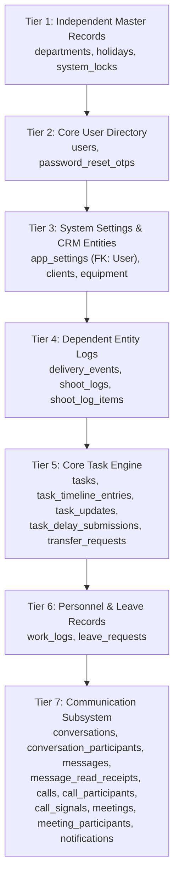

# AVANFlix Work Tracker — MongoDB to PostgreSQL Migration Plan

**Project:** AVANFlix Work Tracker (`employee-work-tracker`)  
**Target Architecture:** PostgreSQL 16+ via Prisma ORM  
**Legacy Source:** MongoDB 8.x via Mongoose 8.7.0  
**Migration Strategy:** Controlled Snapshot ETL $\rightarrow$ Delta Synchronization $\rightarrow$ Verified Cutover $\rightarrow$ Rollback Window $\rightarrow$ Decommission  
**Version:** 2.0.0 (Phase 0 Final Specification)  

---

## 1. Executive Summary & Principles

The migration of AVANFlix Work Tracker from MongoDB to PostgreSQL is a mandatory architectural transition. The system is moving from a schema-flexible document store to a strongly-typed, ACID-compliant relational model to support enterprise workflows, relational integrity, foreign key constraints, and transactional auditing.

### Migration Invariants
1. **PostgreSQL Sole Source of Truth:** At the conclusion of migration, MongoDB is decommissioned.
2. **Zero Data Loss:** Every document, historical timeline entry, chat message, work log, and client record must be completely preserved.
3. **Lineage Preservation:** Original MongoDB 24-character hexadecimal `_id` strings are preserved in indexed `mongoId` columns across all migrated tables, ensuring end-to-end auditability and backward traceability.
4. **Normalized Embedded Arrays:** MongoDB embedded document arrays (`Task.timeline`, `ShootLog.items`, `Call.participants`, etc.) are decomposed into normalized relational child tables with cascade rules.
5. **No Uncontrolled Dual-Writing:** We strictly avoid risky application-level dual-writing. Data synchronization is managed through a deterministic, idempotent ETL engine and delta replays.

---

## 2. Complete Inventory of All 21 MongoDB Models & Relational Target Mapping

Every existing Mongoose model in `models/` is inventoried below with exact source-to-destination field transformations:

### 2.1 Model: `User` $\rightarrow$ Table: `users`
- **Source Mongoose File:** `models/User.ts`
- **Target Table:** `users`
- **Field Mappings:**
  - `_id` (ObjectId) $\rightarrow$ `id` (UUID, Primary Key) + `mongoId` (VARCHAR(24), UNIQUE, INDEX)
  - `name` (String, Required) $\rightarrow$ `name` (VARCHAR(150), NOT NULL)
  - `firstName` (String, Optional) $\rightarrow$ `first_name` (VARCHAR(100), NULL)
  - `lastName` (String, Optional) $\rightarrow$ `last_name` (VARCHAR(100), NULL)
  - `employeeId` (String, Unique, Sparse) $\rightarrow$ `employee_id` (VARCHAR(20), UNIQUE, NULL)
  - `email` (String, Unique, Lowercase) $\rightarrow$ `email` (VARCHAR(255), UNIQUE, NOT NULL, INDEX)
  - `passwordHash` (String, Required) $\rightarrow$ `password_hash` (VARCHAR(255), NOT NULL)
  - `role` (Enum: SUPER_ADMIN, ADMIN, EMPLOYEE) $\rightarrow$ `role` (ENUM: `Role`, NOT NULL, DEFAULT 'EMPLOYEE')
  - `department` (String, Optional) $\rightarrow$ `department` (VARCHAR(100), NULL)
  - `designation` (String, Optional) $\rightarrow$ `designation` (VARCHAR(100), NULL)
  - `joiningDate` (Date, Optional) $\rightarrow$ `joining_date` (DATE, NULL)
  - `isActive` (Boolean, Default true) $\rightarrow$ `is_active` (BOOLEAN, NOT NULL, DEFAULT true)
  - `availabilityStatus` (Enum: ACTIVE, ON_LEAVE, INACTIVE) $\rightarrow$ `availability_status` (ENUM: `AvailabilityStatus`, NOT NULL, DEFAULT 'ACTIVE')
  - `availability` (Enum: AVAILABLE, ON_LEAVE, WFH, HALF_DAY, INACTIVE) $\rightarrow$ `availability_detail` (VARCHAR(50), NOT NULL, DEFAULT 'AVAILABLE')
  - `leaveFrom` (Date, Null) $\rightarrow$ `leave_from` (DATE, NULL)
  - `leaveTo` (Date, Null) $\rightarrow$ `leave_to` (DATE, NULL)
  - `leaveReason` (String, Default "") $\rightarrow$ `leave_reason` (TEXT, DEFAULT '')
  - `phone` (String, Optional) $\rightarrow$ `phone` (VARCHAR(20), NULL)
  - `whatsappOptIn` (Boolean, Default true) $\rightarrow$ `whatsapp_opt_in` (BOOLEAN, NOT NULL, DEFAULT true)
  - `createdAt`, `updatedAt` (Timestamps) $\rightarrow$ `created_at`, `updated_at` (TIMESTAMPTZ, NOT NULL)

---

### 2.2 Model: `Department` $\rightarrow$ Table: `departments`
- **Source:** `models/Department.ts`
- **Mappings:** `_id` $\rightarrow$ `id` (UUID) + `mongoId`, `name` $\rightarrow$ `name` (VARCHAR(100), UNIQUE), `code` $\rightarrow$ `code` (VARCHAR(20), UNIQUE), `isActive` $\rightarrow$ `is_active` (BOOLEAN).

### 2.3 Model: `Holiday` $\rightarrow$ Table: `holidays`
- **Source:** `models/Holiday.ts`
- **Mappings:** `_id` $\rightarrow$ `id` (UUID) + `mongoId`, `name` $\rightarrow$ `name` (VARCHAR(100)), `date` $\rightarrow$ `date` (DATE, INDEX), `year` $\rightarrow$ `year` (INTEGER, INDEX), `description` $\rightarrow$ `description` (TEXT).

### 2.4 Model: `SystemLock` $\rightarrow$ Table: `system_locks`
- **Source:** `models/SystemLock.ts`
- **Mappings:** `_id` $\rightarrow$ `id` (UUID), `key` $\rightarrow$ `key` (VARCHAR(100), UNIQUE), `lockedBy` $\rightarrow$ `locked_by` (VARCHAR(255)), `lockedAt` $\rightarrow$ `locked_at` (TIMESTAMPTZ), `lockedUntil` $\rightarrow$ `locked_until` (TIMESTAMPTZ, INDEX).

### 2.5 Model: `PasswordResetOTP` $\rightarrow$ Table: `password_reset_otps`
- **Source:** `models/PasswordResetOTP.ts`
- **Mappings:** `_id` $\rightarrow$ `id` (UUID), `email` $\rightarrow$ `email` (VARCHAR(255), INDEX), `otpHash` $\rightarrow$ `otp_hash` (VARCHAR(255)), `expiresAt` $\rightarrow$ `expires_at` (TIMESTAMPTZ, INDEX).

### 2.6 Model: `AppSettings` $\rightarrow$ Table: `app_settings`
- **Source:** `models/AppSettings.ts`
- **Mappings:** `_id` $\rightarrow$ `id` (UUID), `leaveApprover` (ObjectId $\rightarrow$ User) $\rightarrow$ `leave_approver_id` (UUID, FOREIGN KEY $\rightarrow$ `users.id`, NULL, `ON DELETE SET NULL`), `updatedAt` $\rightarrow$ `updated_at` (TIMESTAMPTZ).

### 2.7 Model: `Client` $\rightarrow$ Table: `clients`
- **Source:** `models/Client.ts`
- **Mappings:** `_id` $\rightarrow$ `id` (UUID) + `mongoId`, `name` $\rightarrow$ `name` (VARCHAR(150), NOT NULL), `description` $\rightarrow$ `description` (TEXT), `deckLink` $\rightarrow$ `deck_link` (VARCHAR(2000)), `deliverablesLink` $\rightarrow$ `deliverables_link` (VARCHAR(2000)), `contentLink` $\rightarrow$ `content_link` (VARCHAR(2000)), `mouLink` $\rightarrow$ `mou_link` (VARCHAR(2000)), `isActive` $\rightarrow$ `is_active` (BOOLEAN, DEFAULT true), `createdBy` (ObjectId $\rightarrow$ User) $\rightarrow$ `created_by_id` (UUID, FK $\rightarrow$ `users.id`).

### 2.8 Model: `DeliveryEvent` $\rightarrow$ Table: `delivery_events`
- **Source:** `models/DeliveryEvent.ts`
- **Mappings:** `_id` $\rightarrow$ `id` (UUID) + `mongoId`, `client` (ObjectId $\rightarrow$ Client) $\rightarrow$ `client_id` (UUID, FK $\rightarrow$ `clients.id`, `ON DELETE CASCADE`), `title` $\rightarrow$ `title` (VARCHAR(200)), `date` $\rightarrow$ `event_date` (TIMESTAMPTZ, INDEX), `description` $\rightarrow$ `description` (TEXT), `createdBy` (ObjectId $\rightarrow$ User) $\rightarrow$ `created_by_id` (UUID, FK $\rightarrow$ `users.id`).

### 2.9 Model: `Equipment` $\rightarrow$ Table: `equipment`
- **Source:** `models/Equipment.ts`
- **Mappings:** `_id` $\rightarrow$ `id` (UUID) + `mongoId`, `name` $\rightarrow$ `name` (VARCHAR(150)), `category` (Enum: CAMERA, LENS, AUDIO, LIGHTING, GRIP, DRONE, STORAGE, OTHER) $\rightarrow$ `category` (ENUM: `EquipmentCategory`), `code` $\rightarrow$ `code` (VARCHAR(50)), `notes` $\rightarrow$ `notes` (TEXT), `totalQuantity` $\rightarrow$ `total_quantity` (INTEGER, DEFAULT 1), `isActive` $\rightarrow$ `is_active` (BOOLEAN, DEFAULT true), `createdBy` (ObjectId $\rightarrow$ User) $\rightarrow$ `created_by_id` (UUID, FK $\rightarrow$ `users.id`).

### 2.10 Model: `ShootLog` $\rightarrow$ Tables: `shoot_logs` & `shoot_log_items` (Normalized Array)
- **Source:** `models/ShootLog.ts`
- **Parent Table:** `shoot_logs`
  - `_id` $\rightarrow$ `id` (UUID) + `mongoId`, `shootTitle` $\rightarrow$ `shoot_title` (VARCHAR(200)), `shootDate` $\rightarrow$ `shoot_date` (TIMESTAMPTZ, INDEX), `location` $\rightarrow$ `location` (VARCHAR(255)), `takenBy` (ObjectId $\rightarrow$ User) $\rightarrow$ `taken_by_id` (UUID, FK $\rightarrow$ `users.id`), `takenByName` $\rightarrow `taken_by_name` (VARCHAR(150)), `takenByRole` $\rightarrow `taken_by_role` (VARCHAR(50)), `status` ("OUT"/"RETURNED") $\rightarrow `status` (ENUM: `ShootLogStatus`, INDEX), `checkedOutAt` $\rightarrow `checked_out_at` (TIMESTAMPTZ), `returnedAt` $\rightarrow `returned_at` (TIMESTAMPTZ), `returnNote` $\rightarrow `return_note` (TEXT).
- **Child Normalized Table:** `shoot_log_items` (Normalizes `items: IShootLogItemDoc[]`)
  - `id` (UUID, PK), `shoot_log_id` (UUID, FK $\rightarrow$ `shoot_logs.id`, `ON DELETE CASCADE`), `equipment_id` (UUID, FK $\rightarrow$ `equipment.id`), `equipment_name` (VARCHAR(150)), `category` (VARCHAR(50)), `quantity` (INTEGER), `take_note` (TEXT), `return_condition` (ENUM: `OK`, `DAMAGED`, `MISSING`), `return_note` (TEXT).

---

### 2.11 Model: `Task` $\rightarrow$ Tables: `tasks`, `task_timeline_entries`, `task_delay_submissions`, `task_pending_updates`
- **Source:** `models/Task.ts`
- **Parent Table:** `tasks`
  - `_id` $\rightarrow$ `id` (UUID) + `mongoId`, `title` $\rightarrow$ `title` (VARCHAR(255)), `description` $\rightarrow$ `description` (TEXT), `priority` (LOW, MEDIUM, HIGH) $\rightarrow$ `priority` (ENUM: `TaskPriority`), `department` $\rightarrow$ `department` (VARCHAR(100)), `assignedTo` (ObjectId $\rightarrow$ User) $\rightarrow$ `assigned_to_id` (UUID, FK $\rightarrow$ `users.id`, INDEX), `createdBy` (ObjectId $\rightarrow$ User) $\rightarrow$ `created_by_id` (UUID, FK $\rightarrow$ `users.id`), `startDate` $\rightarrow$ `start_date` (DATE), `deadline` $\rightarrow$ `deadline` (DATE, INDEX), `status` $\rightarrow$ `status` (ENUM: `TaskStatus`, INDEX), `stage` $\rightarrow$ `stage` (ENUM: `TaskStage`, INDEX), `completionPercent` $\rightarrow$ `completion_percent` (INTEGER), `stageLink` $\rightarrow$ `stage_link` (VARCHAR(2000)), `stageLinks` $\rightarrow$ `stage_links` (TEXT[]), `stageNote` $\rightarrow$ `stage_note` (TEXT), `timeSpentMinutes` $\rightarrow$ `time_spent_minutes` (INTEGER).
- **Normalized Child Tables:**
  - `task_timeline_entries`: `id` (UUID), `task_id` (UUID, FK $\rightarrow$ `tasks.id`, `ON DELETE CASCADE`), `author_id` (UUID, FK $\rightarrow$ `users.id`), `author_name` (VARCHAR(150)), `action` (VARCHAR(255)), `note` (TEXT), `timestamp` (TIMESTAMPTZ).
  - `task_delay_submissions`: `id` (UUID), `task_id` (UUID, FK $\rightarrow$ `tasks.id`, `ON DELETE CASCADE`), `reason` (TEXT), `expected_completion_date` (DATE), `submitted_at` (TIMESTAMPTZ), `status` (ENUM: PENDING, APPROVED, REJECTED), `reviewed_by_id` (UUID, FK $\rightarrow$ `users.id`), `reviewed_at` (TIMESTAMPTZ).
  - `task_pending_updates`: `id` (UUID), `task_id` (UUID, FK $\rightarrow$ `tasks.id`, `ON DELETE CASCADE`), `status` (VARCHAR(50)), `progress_percent` (INTEGER), `work_done` (TEXT), `comment` (TEXT), `issue_description` (TEXT), `time_spent_minutes` (INTEGER), `estimated_completion_date` (DATE), `submitted_by_id` (UUID, FK $\rightarrow$ `users.id`), `review_status` (VARCHAR(50)), `reviewed_by_id` (UUID, FK $\rightarrow$ `users.id`).

### 2.12 Model: `TaskUpdate` $\rightarrow$ Table: `task_updates`
- **Source:** `models/TaskUpdate.ts`
- **Mappings:** `_id` $\rightarrow$ `id` (UUID), `task` (ObjectId $\rightarrow$ Task) $\rightarrow$ `task_id` (UUID, FK $\rightarrow$ `tasks.id`, `ON DELETE CASCADE`), `author` (ObjectId $\rightarrow$ User) $\rightarrow$ `author_id` (UUID, FK $\rightarrow$ `users.id`), `authorName` $\rightarrow$ `author_name` (VARCHAR(150)), `action` $\rightarrow$ `action` (VARCHAR(255)), `progressPercent` $\rightarrow$ `progress_percent` (INTEGER), `workDone` $\rightarrow$ `work_done` (TEXT), `comment` $\rightarrow$ `comment` (TEXT), `createdAt` $\rightarrow$ `created_at` (TIMESTAMPTZ).

### 2.13 Model: `TransferRequest` $\rightarrow$ Table: `transfer_requests`
- **Source:** `models/TransferRequest.ts`
- **Mappings:** `_id` $\rightarrow$ `id` (UUID), `task` (ObjectId $\rightarrow$ Task) $\rightarrow$ `task_id` (UUID, FK $\rightarrow$ `tasks.id`, `ON DELETE CASCADE`), `requestedBy` (ObjectId $\rightarrow$ User) $\rightarrow$ `requested_by_id` (UUID, FK $\rightarrow$ `users.id`), `transferTo` (ObjectId $\rightarrow$ User) $\rightarrow$ `transfer_to_id` (UUID, FK $\rightarrow$ `users.id`), `reason` $\rightarrow$ `reason` (TEXT), `status` (PENDING, APPROVED, REJECTED) $\rightarrow$ `status` (VARCHAR(50)), `reviewedBy` (ObjectId $\rightarrow$ User) $\rightarrow$ `reviewed_by_id` (UUID, FK $\rightarrow$ `users.id`).

### 2.14 Model: `WorkLog` $\rightarrow$ Table: `work_logs`
- **Source:** `models/WorkLog.ts`
- **Mappings:** `_id` $\rightarrow$ `id` (UUID) + `mongoId`, `employee` (ObjectId $\rightarrow$ User) $\rightarrow$ `employee_id` (UUID, FK $\rightarrow$ `users.id`, INDEX), `date` $\rightarrow$ `log_date` (DATE, INDEX), `summary` $\rightarrow$ `summary` (TEXT), `blockers` $\rightarrow$ `blockers` (TEXT), `notes` $\rightarrow$ `notes` (TEXT), `submittedAt` $\rightarrow$ `submitted_at` (TIMESTAMPTZ), `createdAt`, `updatedAt` (TIMESTAMPTZ). Unique constraint: `UNIQUE(employee_id, log_date)`.

### 2.15 Model: `LeaveRequest` $\rightarrow$ Table: `leave_requests`
- **Source:** `models/LeaveRequest.ts`
- **Mappings:** `_id` $\rightarrow$ `id` (UUID) + `mongoId`, `requestedBy` (ObjectId $\rightarrow$ User) $\rightarrow$ `requested_by_id` (UUID, FK $\rightarrow$ `users.id`, INDEX), `leaveFrom` $\rightarrow$ `leave_from` (DATE, INDEX), `leaveTo` $\rightarrow$ `leave_to` (DATE, INDEX), `leaveType` (CASUAL, SICK, UNPAID, EMERGENCY) $\rightarrow$ `leave_type` (ENUM: `LeaveType`), `reason` $\rightarrow$ `reason` (TEXT), `status` (PENDING, APPROVED, REJECTED, WITHDRAWN) $\rightarrow$ `status` (ENUM: `LeaveStatus`, INDEX), `reviewedBy` (ObjectId $\rightarrow$ User) $\rightarrow$ `reviewed_by_id` (UUID, FK $\rightarrow$ `users.id`), `reviewedAt` $\rightarrow$ `reviewed_at` (TIMESTAMPTZ), `rejectionReason` $\rightarrow$ `rejection_reason` (TEXT).

### 2.16 Model: `Conversation` $\rightarrow$ Tables: `conversations` & `conversation_participants`
- **Source:** `models/Conversation.ts`
- **Parent Table:** `conversations`
  - `_id` $\rightarrow$ `id` (UUID) + `mongoId`, `type` (DIRECT, GROUP) $\rightarrow$ `type` (ENUM: `ConversationType`), `title` $\rightarrow$ `title` (VARCHAR(150)), `lastMessageAt` $\rightarrow$ `last_message_at` (TIMESTAMPTZ, INDEX).
- **Normalized Join Table:** `conversation_participants`
  - `conversation_id` (UUID, FK $\rightarrow$ `conversations.id`, `ON DELETE CASCADE`), `user_id` (UUID, FK $\rightarrow$ `users.id`, `ON DELETE CASCADE`), `joined_at` (TIMESTAMPTZ). Primary Key: `(conversation_id, user_id)`.

### 2.17 Model: `Message` $\rightarrow$ Tables: `messages` & `message_read_receipts`
- **Source:** `models/Message.ts`
- **Parent Table:** `messages`
  - `_id` $\rightarrow$ `id` (UUID) + `mongoId`, `conversation` (ObjectId $\rightarrow$ Conversation) $\rightarrow$ `conversation_id` (UUID, FK $\rightarrow$ `conversations.id`, `ON DELETE CASCADE`, INDEX), `sender` (ObjectId $\rightarrow$ User) $\rightarrow$ `sender_id` (UUID, FK $\rightarrow$ `users.id`), `content` $\rightarrow$ `content` (TEXT), `createdAt` $\rightarrow$ `created_at` (TIMESTAMPTZ, INDEX).
- **Normalized Child Table:** `message_read_receipts`
  - `message_id` (UUID, FK $\rightarrow$ `messages.id`, `ON DELETE CASCADE`), `user_id` (UUID, FK $\rightarrow$ `users.id`, `ON DELETE CASCADE`), `read_at` (TIMESTAMPTZ). Primary Key: `(message_id, user_id)`.

### 2.18 Model: `Call` $\rightarrow$ Tables: `calls` & `call_participants`
- **Source:** `models/Call.ts`
- **Parent Table:** `calls`
  - `_id` $\rightarrow$ `id` (UUID) + `mongoId`, `type` (DIRECT, MEETING) $\rightarrow$ `type` (ENUM: `CallType`), `callType` (AUDIO, VIDEO) $\rightarrow$ `call_media_type` (ENUM: `CallMediaType`), `initiator` (ObjectId $\rightarrow$ User) $\rightarrow$ `initiator_id` (UUID, FK $\rightarrow$ `users.id`), `status` (RINGING, ACTIVE, ENDED, MISSED, DECLINED) $\rightarrow$ `status` (ENUM: `CallStatus`, INDEX), `startedAt` $\rightarrow$ `started_at` (TIMESTAMPTZ), `endedAt` $\rightarrow$ `ended_at` (TIMESTAMPTZ).
- **Normalized Child Table:** `call_participants`
  - `call_id` (UUID, FK $\rightarrow$ `calls.id`, `ON DELETE CASCADE`), `user_id` (UUID, FK $\rightarrow$ `users.id`), `status` (RINGING, JOINED, DECLINED, LEFT), `joined_at` (TIMESTAMPTZ), `left_at` (TIMESTAMPTZ). Primary Key: `(call_id, user_id)`.

### 2.19 Model: `CallSignal` $\rightarrow$ Table: `call_signals`
- **Source:** `models/CallSignal.ts`
- **Mappings:** `_id` $\rightarrow$ `id` (UUID), `call` (ObjectId $\rightarrow$ Call) $\rightarrow$ `call_id` (UUID, FK $\rightarrow$ `calls.id`, `ON DELETE CASCADE`), `from` (ObjectId $\rightarrow$ User) $\rightarrow$ `from_user_id` (UUID, FK $\rightarrow$ `users.id`), `to` (ObjectId $\rightarrow$ User) $\rightarrow$ `to_user_id` (UUID, FK $\rightarrow$ `users.id`), `type` (SDP_OFFER, SDP_ANSWER, ICE_CANDIDATE) $\rightarrow$ `signal_type` (VARCHAR(50)), `payload` (String/JSON) $\rightarrow$ `payload` (JSONB), `createdAt` $\rightarrow$ `created_at` (TIMESTAMPTZ, INDEX).

### 2.20 Model: `Meeting` $\rightarrow$ Tables: `meetings` & `meeting_participants`
- **Source:** `models/Meeting.ts`
- **Parent Table:** `meetings`
  - `_id` $\rightarrow$ `id` (UUID) + `mongoId`, `title` $\rightarrow$ `title` (VARCHAR(200)), `description` $\rightarrow$ `description` (TEXT), `scheduledAt` $\rightarrow$ `scheduled_at` (TIMESTAMPTZ, INDEX), `durationMinutes` $\rightarrow$ `duration_minutes` (INTEGER), `host` (ObjectId $\rightarrow$ User) $\rightarrow$ `host_id` (UUID, FK $\rightarrow$ `users.id`), `status` (SCHEDULED, IN_PROGRESS, COMPLETED, CANCELLED) $\rightarrow$ `status` (ENUM: `MeetingStatus`).
- **Normalized Join Table:** `meeting_participants`
  - `meeting_id` (UUID, FK $\rightarrow$ `meetings.id`, `ON DELETE CASCADE`), `user_id` (UUID, FK $\rightarrow$ `users.id`, `ON DELETE CASCADE`), `status` (INVITED, ACCEPTED, DECLINED). Primary Key: `(meeting_id, user_id)`.

### 2.21 Model: `Notification` $\rightarrow$ Table: `notifications`
- **Source:** `models/Notification.ts`
- **Mappings:** `_id` $\rightarrow$ `id` (UUID) + `mongoId`, `recipient` (ObjectId $\rightarrow$ User) $\rightarrow$ `recipient_id` (UUID, FK $\rightarrow$ `users.id`, INDEX), `title` $\rightarrow$ `title` (VARCHAR(255)), `message` $\rightarrow$ `message` (TEXT), `type` $\rightarrow$ `type` (ENUM: `NotificationType`), `relatedTask` (ObjectId $\rightarrow$ Task) $\rightarrow$ `related_task_id` (UUID, FK $\rightarrow$ `tasks.id`, `ON DELETE SET NULL`), `isRead` $\rightarrow$ `is_read` (BOOLEAN, DEFAULT false, INDEX), `createdAt` $\rightarrow$ `created_at` (TIMESTAMPTZ, INDEX).

---

## 3. Dependency-Safe Migration Execution Sequence

To prevent foreign key constraint violations during bulk data migration, the migration script MUST execute in strict dependency order:



### Resolution of the `AppSettings` Dependency
In MongoDB, `AppSettings` contains `leaveApprover` referencing a `User`. If `AppSettings` were migrated before `User`, a foreign key violation would occur. The order above places `User` in **Tier 2**, before `AppSettings` in **Tier 3**, completely eliminating the dependency ordering conflict.

---

## 4. Controlled Migration Methodology

```
┌──────────────────────────────────────────────────────────────────────────────────┐
│                             MIGRATION ARCHITECTURE                               │
│                                                                                  │
│  [MongoDB Production]                                                            │
│         │ (Consistent Snapshot / mongodump with oplog)                           │
│         ▼                                                                        │
│  [ETL Runner Script] (scripts/migrate-mongo-to-postgres.ts)                      │
│         │                                                                        │
│         ├── Step 1: Ingest batch with cursor pagination                          │
│         ├── Step 2: Query migration_id_mappings table (Cache ObjectId -> UUID)   │
│         ├── Step 3: Deconstruct embedded arrays (timeline, items, participants)  │
│         ├── Step 4: Batch INSERT into PostgreSQL tables in Tier order             │
│         └── Step 5: Write back generated UUIDs into migration_id_mappings        │
│         │                                                                        │
│         ▼                                                                        │
│  [PostgreSQL 16 Database]                                                        │
│         ▲                                                                        │
│         │ (SHA-256 Row Hash & Aggregate Count Comparison Engine)                 │
│  [Validation Runner]                                                             │
└──────────────────────────────────────────────────────────────────────────────────┘
```

### 4.1 Idempotent Batch Synchronization Engine
1. **Persistent ID Translation Table (`migration_id_mappings`):**
   ```sql
   CREATE TABLE migration_id_mappings (
       collection_name VARCHAR(100) NOT NULL,
       mongo_id VARCHAR(24) NOT NULL,
       pg_uuid UUID NOT NULL,
       created_at TIMESTAMPTZ DEFAULT CURRENT_TIMESTAMP,
       PRIMARY KEY (collection_name, mongo_id)
   );
   CREATE INDEX idx_migration_pg_uuid ON migration_id_mappings(pg_uuid);
   ```
   Every converted MongoDB document stores its mapping in this table. Re-running the migration skips already-migrated documents, guaranteeing idempotency.

2. **Foreign Key Translation Function:**
   When importing `Task.assignedTo`, the ETL script resolves `mappedUuid = mappingCache.get("users", doc.assignedTo.toString())`. If an orphaned reference is detected, the script logs the anomaly to a quarantine table rather than aborting.

### 4.2 Data Integrity & Checksum Verification
Following ETL completion, an automated validation script (`scripts/verify-migration-checksums.ts`) executes:
1. **Row Count Audit:** Verifies `COUNT(*)` matches between MongoDB and PostgreSQL for all 21 models.
2. **Normalized Array Integrity:** Verifies that $\sum \text{items across all ShootLogs in Mongo} = \text{COUNT(*) in shoot\_log\_items}$.
3. **Aggregate Hash Checksum:**
   - Concatenates critical business fields (e.g. `User: email + employeeId + role + passwordHash`).
   - Generates SHA-256 hashes per record and compares set equality.
4. **Foreign Key Integrity Audit:** Executes `SELECT ... WHERE fk_id IS NOT NULL AND fk_id NOT IN (SELECT id FROM parent_table)` across all foreign keys to verify zero orphan records.

### 4.3 Controlled Cutover Window
1. **Step 1: Write Freeze (Duration: 15 minutes):** Enable a maintenance banner. Put MongoDB in read-only mode (`db.fsyncLock()`).
2. **Step 2: Delta Replication:** The ETL script runs in delta mode, copying all records created or modified since the initial snapshot timestamp (`updatedAt >= :last_sync_timestamp`).
3. **Step 3: Verification Verification:** Run checksum validation on delta rows.
4. **Step 4: Environment Variable Switch:** Update application configuration:
   `DATABASE_DRIVER=postgresql`
   `DATABASE_URL=postgresql://...`
5. **Step 5: Lift Maintenance Banner:** Re-enable traffic. All writes and reads target PostgreSQL.

---

## 5. Technically Valid Rollback & Recovery Strategy

Rollback cannot simply rely on "switching back to MongoDB" if production writes have occurred in PostgreSQL. The recovery mechanism is defined by the elapsed time post-cutover:

### Scenario A: Rollback During Cutover Window (< 15 Minutes, Zero Production Writes in PostgreSQL)
1. Revert `DATABASE_DRIVER` environment variable back to `mongodb`.
2. Unlock MongoDB (`db.fsyncUnlock()`).
3. Restart Next.js application instances.
4. **Time to Recover:** < 2 minutes. **Data Loss:** Zero.

### Scenario B: Post-Cutover Rollback (< 72 Hours, Production Writes Occurred in PostgreSQL)
If an unforeseen critical failure occurs after live users have created tasks, work logs, or checkouts in PostgreSQL:
1. **Reverse Delta Synchronization Engine (`scripts/reverse-sync-pg-to-mongo.ts`):**
   - Reads all records in PostgreSQL created or modified after cutover timestamp (`created_at >= :cutover_time`).
   - Translates PostgreSQL UUIDs back to MongoDB ObjectIds using `migration_id_mappings` (for historical records) or generates deterministic ObjectIds for new records.
   - Reconstructs embedded arrays (`shoot_log_items` $\rightarrow$ `ShootLog.items`, `task_timeline_entries` $\rightarrow$ `Task.timeline`).
   - Performs bulk upserts into MongoDB.
2. Verify reverse sync row counts.
3. Switch application environment variable back to `DATABASE_DRIVER=mongodb`.
4. **Time to Recover:** < 20 minutes. **Data Loss:** Zero.
