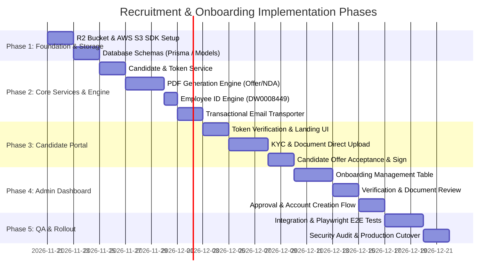

# AVANFlix Work Tracker — Onboarding Implementation Roadmap

**Module:** Employee Recruitment & Onboarding Module  
**Project:** AVANFlix Work Tracker (`employee-work-tracker`)  
**Execution Mode:** Phased Iterative Delivery with Zero Downtime  
**Status:** Approved Phase 0 Specification  

---

## 1. Roadmap Overview & Milestones

The recruitment and onboarding module will be constructed across 5 strategic phases to guarantee that the operational tracking software remains completely stable throughout implementation.

---

## 2. Phase-by-Phase Implementation Breakdown

### Phase 1: Cloud Storage & Database Architecture
- **Deliverables:**
  1. Configure Cloudflare R2 bucket (`avanflix-onboarding-docs`) with CORS policies for presigned PUT/GET requests.
  2. Implement `lib/r2.ts` client wrapper using `@aws-sdk/client-s3` and `@aws-sdk/s3-request-presigner`.
  3. Instantiate the onboarding database schema (compatible with both Mongoose in MongoDB and Prisma in PostgreSQL).
  4. Implement data encryption utility `lib/crypto.ts` for AES-256-GCM encryption of Aadhaar, PAN, and Bank details.
- **Verification:** Unit tests confirming R2 connectivity, presigned URL generation, and encryption/decryption roundtrips.

---

### Phase 2: Core Services & Document Generation Engine
- **Deliverables:**
  1. Implement `services/candidateService.ts`: Candidate creation, token generation, status transitions, and audit logging.
  2. Implement `services/documentGenerator.ts`: HTML-to-PDF / PDFKit rendering for Offer Letter, Joining Letter, NDA, NOC, and Welcome Letter with AVANFlix branding and dynamic compensation breakdown.
  3. Implement `services/employeeIdService.ts`: Formula engine enforcing `D` + initial + `000` + 4-digit sequence (e.g. `DW0008449`) with atomic collision resolution.
  4. Extend `lib/mailer.ts`: Multi-stage email dispatchers (Candidate Invite, Offer/Joining transmission, NDA/NOC legal transmission, Welcome Letter).
  5. Connect `taskService.ts` and `notificationService.ts`: Automatic task spawning and coordinator notifications upon candidate creation and completion.
- **Verification:** Automated generation of all 5 document types, email preview verification, and collision tests.

---

### Phase 3: Candidate Public Portal (`/onboard/[token]`)
- **Deliverables:**
  1. Responsive Next.js App Router candidate landing route: `app/(public)/onboard/[token]/page.tsx`.
  2. Multi-step onboarding application form:
     - Step 1: Personal info & Emergency Contact
     - Step 2: Aadhaar, PAN & Photograph upload (direct to R2 via pre-signed URL)
     - Step 3: Bank Details & Cancelled Cheque upload
     - Step 4: Review, declarations & submission
  3. Document Signing & Re-upload Portal:
     - Candidate downloads generated Offer, Joining, NDA, NOC.
     - Upload interface for signed agreements with progress bars and MIME validation.
- **Verification:** Mobile and desktop responsive UX, client-side validation using Zod, secure direct upload without server proxying.

---

### Phase 4: Administrative Management Dashboard
- **Deliverables:**
  1. Admin dashboard route `app/dashboard/onboarding/page.tsx` with candidate directory, status tabs, search, and department filters.
  2. Candidate Detail & Review Drawer / Modal:
     - Inspection of personal, KYC, and bank information (with RBAC masking for non-admin viewers).
     - Inline PDF document preview using short-lived pre-signed R2 URLs.
     - Action buttons: "Approve Info", "Request Corrections", "Reject", "Verify Signed Docs", "Grant Final Approval".
  3. Super Admin Final Approval Pipeline:
     - Trigger deterministic employee ID generation.
     - Automatic creation of active user account in `User`.
     - Dispatch Welcome Letter and spawn post-onboarding tasks.
- **Verification:** Complete end-to-end management walkthrough in staging environment.

---

### Phase 5: Testing, Hardening & Production Rollout
- **Deliverables:**
  1. **Automated Unit Tests:** Full test coverage across Candidate service, Employee ID generation, and R2 client.
  2. **Automated Integration Tests:** API route tests verifying RBAC authorization, token invalidation, and data encryption.
  3. **Playwright E2E Test Suite:** Simulated candidate onboarding journey from Super Admin creation to candidate submission, approval, signing, and employee creation.
  4. **Security & Privacy Audit:** Verify zero sensitive document attachments in emails, zero PII leaks, and strict proxy protection.
- **Verification:** 100% test pass rate, clean `npm run build`, and production deployment.

---

## 3. Risk Assessment & Mitigation Matrix

| Risk Factor | Impact | Likelihood | Mitigation Strategy |
|---|---|---|---|
| **PII Data Leak (Aadhaar / Bank)** | High | Low | Enforce AES-256-GCM encryption at rest, short-lived 5-minute pre-signed R2 URLs, and zero email attachments. |
| **Employee ID Collision** | Medium | Low | Collision loop testing up to 10 retries + explicit `UNIQUE` index constraint on `employeeId` in database. |
| **Email Delivery Failures** | Medium | Medium | Transactional email retry queue; fallback download links directly accessible via candidate token portal. |
| **Large KYC Uploads Exhausting Server** | High | Low | Direct-to-R2 presigned `PUT` uploads bypass Next.js server memory and bandwidth entirely. |
| **Tampered / Fake Candidate Links** | High | Low | High-entropy 256-bit cryptographic tokens with 7-day expiration; token invalidated immediately upon completion. |
| **Regression in Existing Tasks / Users** | High | Low | Candidate data strictly isolated in separate tables; User record created only upon final milestone. |

---

## 4. Phase 0 Acceptance & Sign-Off Criteria

Phase 0 is complete when the user and stakeholders review and approve the 6 architecture documents:
1. `EMPLOYEE_ONBOARDING_ARCHITECTURE.md`
2. `MONGODB_TO_POSTGRESQL_MIGRATION_PLAN.md`
3. `ONBOARDING_DATABASE_DESIGN.md`
4. `ONBOARDING_WORKFLOW.md`
5. `ONBOARDING_RBAC_MATRIX.md`
6. `ONBOARDING_IMPLEMENTATION_ROADMAP.md`

Upon approval, Phase 1 execution will commence immediately.
