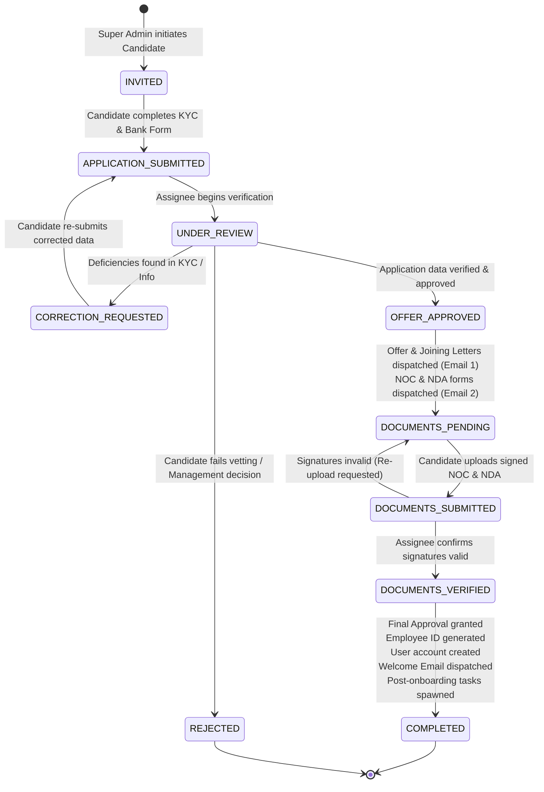

# AVANFlix Work Tracker — Employee Onboarding Workflow

**Module:** End-to-End Recruitment & Onboarding Lifecycle  
**Architecture Spec:** Workflow Engine & State Machine  
**Status:** Approved Phase 0 Specification  

---

## 1. Candidate Lifecycle State Machine

---

## 2. Detailed Step-by-Step Lifecycle Execution

### Step 1: Candidate Initiation (Super Admin)
- **Actor:** `SUPER_ADMIN`
- **Input Parameters:**
  - `firstName`, `lastName`, `email`
  - `designation`, `department`
  - `employmentType`: `EMPLOYEE` (with monthly salary) or `INTERN` (paid stipend or unpaid)
  - `salaryOrStipend`: numeric compensation amount
  - `proposedJoiningDate`: target reporting date
  - `assignedTo`: Admin or authorized Employee responsible for coordinator duties
- **System Actions:**
  1. Creates candidate record with status `INVITED`.
  2. Generates a secure, 256-bit cryptographic token with a 7-day expiration.
  3. Records entry in `onboarding_audit_logs`.

### Step 2: Automatic Onboarding Task & Notification Dispatch
- **System Actions:**
  1. Automatically invokes `taskService.create()`:
     - Title: `Onboarding: [First Name] [Last Name] — [Designation]`
     - Department: Candidate's department
     - Priority: `HIGH`
     - Start Date: Today
     - Deadline: `proposedJoiningDate`
     - Stage: `CHECKLIST`
     - Assignee: Selected `assignedTo` user
  2. Links generated task ID to `candidate.onboarding_task_id`.
  3. Dispatches in-app notification and WhatsApp message to the assignee via `notificationService.create()`.
  4. Dispatches the initial invitation email to the candidate containing their personalized portal access link:
     `https://app.avanflix.com/onboard/[token]`

---

### Step 3: Candidate Portal Submission
- **Actor:** Candidate (External, via single-purpose token URL)
- **Data Collected:**
  - **Personal Details:** Full name confirmation, Mobile number, Address, Date of Birth, Emergency contact (Name, Phone, Relationship).
  - **Identity KYC:** Aadhaar number, Aadhaar front image, Aadhaar back image, PAN number, PAN image, Candidate passport photograph.
  - **Bank Details:** Account holder name, Account number, IFSC code, Bank name, Branch name, Cancelled cheque / Passbook image.
  - **Employment Confirmation:** View-only confirmation of designation, department, compensation, and joining date.
- **Upload Mechanism:**
  - Frontend requests pre-signed `PUT` URLs from `/api/onboarding/upload-url`.
  - Images and PDFs stream directly to private Cloudflare R2 bucket (`avanflix-onboarding-docs`).
- **Submission:**
  - Transition status from `INVITED` to `APPLICATION_SUBMITTED`.
  - Notifies assigned onboarding coordinator that application has been submitted.

---

### Step 4: Verification & Approval Review
- **Actor:** Assigned Admin, Super Admin, or authorized HR Employee.
- **Actions Available:**
  1. **Request Corrections:** If documents are blurry, IFSC is invalid, or details mismatch.
     - Status $\rightarrow$ `CORRECTION_REQUESTED`.
     - System emails candidate specifying exact correction notes.
     - Candidate portal unlocks for resubmission.
  2. **Reject Candidate:**
     - Status $\rightarrow$ `REJECTED`.
     - Records reason in audit log; candidate portal access revoked.
  3. **Approve Application:**
     - Status $\rightarrow$ `OFFER_APPROVED`.
     - Triggers automated document generation engine.

---

### Step 5: Document Generation & Two-Phase Distribution
Upon application approval, the system generates customized PDF legal agreements:

1. **Phase 1 Transmission (Email 1 — Appointment Package):**
   - **Offer Letter:** Formal job offer containing compensation structure, employment classification, working hours, and benefits.
   - **Joining Letter:** Official confirmation of acceptance and orientation details.
   - **Delivery:** Dispatched to candidate email with secure Cloudflare R2 download links.

2. **Phase 2 Transmission (Email 2 — Legal & Compliance Package):**
   - **Non-Disclosure Agreement (NDA):** Comprehensive intellectual property, confidential media, and client data protection agreement.
   - **No Objection Certificate (NOC) / Code of Conduct:** Company studio policy compliance and equipment usage protocol.
   - **Instructions:** Candidate is directed to print/digitally sign both agreements and re-upload them via their portal.
   - Status transitions to `DOCUMENTS_PENDING`.

---

### Step 6: Signed Document Verification
- **Actor:** Candidate uploads signed NDA and NOC PDFs/images to the portal.
- **Status:** Transitions to `DOCUMENTS_SUBMITTED`.
- **Review:** Assigned coordinator verifies signatures, dates, and completeness.
  - If invalid: Rejection note sent $\rightarrow$ Candidate re-uploads.
  - If valid: Mark documents verified $\rightarrow$ Status transitions to `DOCUMENTS_VERIFIED`.

---

### Step 7: Final Approval & Employee Provisioning
- **Actor:** `SUPER_ADMIN` (or designated Lead HR Admin).
- **Execution Pipeline (Atomic & Transactional):**
  1. **Generate Employee ID:**
     - Evaluates designation initial.
     - Executes collision-checked formula: `D` + initial + `000` + random 4 digits (e.g. `DW0008449`).
     - Verifies uniqueness against `users.employeeId` and `candidates.generated_employee_id`.
  2. **Create Core Employee Account:**
     - Creates new record in `User` (`name`, `firstName`, `lastName`, `email`, `employeeId`, `role: EMPLOYEE`, `department`, `designation`, `joiningDate`, `isActive: true`, `phone`).
     - Generates secure temporary password hash and flags account for initial password change on first login.
  3. **Generate & Dispatch Welcome Letter (Email 3):**
     - Personalized Welcome Letter containing official Employee ID, company credentials, corporate portal instructions, and Day-1 reporting guidelines.
  4. **Post-Onboarding Task Automation:**
     - The existing onboarding task is updated to `COMPLETED`.
     - Automatically spawns post-onboarding tasks assigned to the coordinator:
       - Allocate studio workstation & access card.
       - Provision internal communications (Slack / Google Workspace / In-App Chat).
       - Issue standard equipment kit (camera/laptop) via `shootLogService`.
       - Conduct team introduction and training orientation.
  5. **Status Finalization:** Candidate record marked `COMPLETED`.
